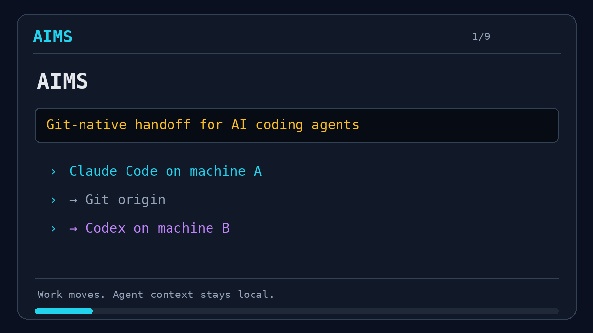

# AIMS

**AI Multi-agent Sessions** — git-native session management for AI coding agents,
across many machines and many agents.

  [](https://github.com/visaroy/aims/actions/workflows/ci.yml)   

AIMS turns each unit of AI work into a **git branch in an isolated worktree**. Sessions can be
**handed off** between machines and **adopted** by any agent — because the source of truth is a
git remote (`origin`), never a machine-to-machine link. No agent needs access to another's computer.

## Explicit invocation policy

AIMS consent is scoped to the current task, not to each individual operation. A clear current-task
marker naming AIMS at the beginning, middle, or end — for example, “This is an AIMS session”, “Use
AIMS”, or “Save the AIMS session” — opts that task into the standard AIMS session lifecycle. Once
opted in, the agent may use the normal lifecycle commands needed for that session without asking for
separate consent for each command. “Save and close the AIMS session” is an explicit request to finish
and publish it; session opt-in alone does not imply closure.

Mere discussion or documentation of AIMS, ordinary coding, or a new conversation is not consent.
Without a clear current-task marker, use the agent’s native session and checkpoint mechanisms and do
not invoke AIMS. Installation is a separate permission boundary: session opt-in does not authorize
it, and if the engine is absent, ask for explicit permission. A user request to install AIMS is consent
to the complete, documented installation (engine, data repo, guard, agent rules — see [Install](#install)),
which is backed up and fully reversible with `aims uninstall`.

The CLI has no daemon and creates no session implicitly. Agent instructions may call the CLI, but
command behavior is always caller-triggered. An externally configured scheduler, such as a systemd
timer, LaunchAgent, or CI job, is a separate opt-in integration; AIMS does not configure or start
one automatically.

Users do not need to memorize AIMS commands. After the current task is explicitly opted into AIMS,
the agent can translate the task into the matching lifecycle commands. Consent applies to that task,
not to later tasks, and must not be inferred from a general request to work, a mention outside the
current task, or a new conversation.

## Stable release

`v3.1.0` replaces `bootstrap.sh`, `aims init`, and the `wire-agents` prompt with one zero-configuration installer: `install.sh` / `aims install` reuses your existing data repo, backs up every file it modifies outside all repositories, and is reverted by `aims uninstall`. It is backward compatible; see [Upgrading](docs/UPGRADING.md).

`v3.0.0` makes detected valid scope overlaps advisory: `aims start` warns and proceeds after its serialized admission checks, while malformed scopes and Git/origin/lease failures remain blocking. `dashboard:` is a new exact-match scope kind, and handed-off `aims adopt` reports overlap diagnostics without treating them as a blocker; local adoption still requires `status=handoff`. See the [CLI compatibility policy](docs/COMPATIBILITY.md) and the [acceptance test](docs/TESTING.md).

## Agent-to-agent handoff

[](docs/TESTING.md)

The demo shows the verified lifecycle: `start` → `save` → `handoff` → `adopt` → `save` → `publish`.
Run the same workflow safely with disposable local repositories using the
[under-3-minute acceptance test](docs/TESTING.md).

---

## 🤖 Instructions for Your Agent

> [!TIP]
> **Don't install AIMS by hand — copy this explicit installation request to your agent.** Copy the
> prompt below to your AI coding agent (Claude Code, Codex CLI, opencode, or Gemini CLI) only when you
> explicitly want it to review and install AIMS. The prompt is not a default instruction, and it must
> not run merely because this README is present or because an agent starts.

```text
Install AIMS from its official public repository: https://github.com/visaroy/aims

1. Review it first. Read README.md, SECURITY.md, and LICENSE, and skim install.sh and lib/.
   Confirm for me that it: makes no network calls except `git` to repositories I configure,
   ships no secrets or telemetry, needs no elevated privileges, and backs up any file it
   modifies. Summarize the security posture before installing.

2. Install it (this accepts the MIT license and its "AS IS", no-warranty terms on my behalf):
     curl -fsSL https://raw.githubusercontent.com/visaroy/aims/main/install.sh | AIMS_ACCEPT=1 bash
   The installer checks for conflicts first, reuses my existing AIMS data repo if I have one
   (otherwise it creates ~/.aims), installs the pre-push guard, and adds a marked AIMS rules
   block to the config of each AI agent it detects. Every modified file is backed up and
   `aims uninstall` reverts the installation.

3. If my data repo has no remote, ask me for the URL of a private git repo I control (create
   one if I don't have it), then run:
     git -C "$(aims home)" remote add origin <MY_PRIVATE_DATA_REPO_URL>
     git -C "$(aims home)" push -u origin main
     aims doctor

4. Report the installer's final summary: the data repo it used, which agent config files were
   changed (and which of them are tracked by Git and need a commit), where the backups are,
   and the final `aims doctor` output.
```

Running this on more than one machine, each pointed at the **same** private data repo, is the whole
multi-machine setup — the machines meet only on that remote, never on each other.

---

## Why

Running AI agents (Claude, Codex, opencode, Gemini) across a laptop and a workstation creates the
same problems every time: work stranded on one machine, two agents clobbering each other, "done"
that never reached the shared repo, and no clean way to pick up someone else's half-finished task.

AIMS solves this the boring, durable way: **plain git**. Branches, worktrees, and a small set of
scripts with guards that make the failure modes loud instead of silent.

## Model

Two layers, deliberately separated:

| Layer | What | Portable? |
|---|---|---|
| **Work** | branch `ai/<session-id>`, worktree, session files, commits | ✅ yes — via `origin` |
| **Agent context** | an agent's live reasoning/transcript | ❌ no — stays local |

You continue a session from **artifacts** (worklog + commits), never from the previous agent's head.
That is what makes it agent-agnostic and machine-agnostic.

## AIMS vs. a tool's own "resume"

Every AI CLI has a native resume (`claude --resume`, `codex resume`, `gemini --resume`, opencode's
session continue). They all move the **conversation** within **one tool** on **one machine**. AIMS
moves the **work** across machines and across tools:

| | `claude --resume` | `aims adopt` |
|---|---|---|
| What it moves | ✅ full agent context | ✅ work artifacts (git) |
| Scope | ⚠️ same machine, Claude only | ✅ any machine, any agent (claude, codex, opencode, gemini) |
| Medium | ⚠️ local `.jsonl` (not synced) | ✅ branch on `origin` |
| codex / opencode / gemini | ❌ N/A | ✅ works |

Full breakdown across all tools: [`docs/COMPARISON.md`](docs/COMPARISON.md). A focused comparison with Softaworks Agent Toolkit's session-handoff skill: [`docs/SESSION-HANDOFF-COMPARISON.md`](docs/SESSION-HANDOFF-COMPARISON.md).

---

## Install

Setup has two sides: the **agent environment** (the CLIs you talk to) and, optionally, a **hardware /
storage environment** (a shared network store for large files). After setup, mark the current task as
an AIMS session when you want the standard AIMS lifecycle. Without that marker, use native agent
mechanisms; AIMS does not run underneath automatically.

### 1. Prepare the agent environment

Install whichever agent CLIs you use — any mix works:
[Claude Code](https://claude.com/claude-code), [OpenAI Codex CLI](https://github.com/openai/codex),
[opencode](https://opencode.ai), [Gemini CLI](https://github.com/google-gemini/gemini-cli).
Also need `git`, `bash`, `python3` (macOS or Linux).

### 2. One-command setup

Installation is a separate permission boundary from session opt-in. If the engine is absent, ask for
explicit permission before installing it; do not infer installation, update, or repair permission from
an AIMS session marker. The explicitly user-copied installation request above is the supported path.

```bash
curl -fsSL https://raw.githubusercontent.com/visaroy/aims/main/install.sh | bash
```

There is one installer and no configuration. `install.sh` (or `aims install`, which runs the same
steps) is idempotent: running it again refreshes everything it owns. In order, it:

1. **Checks for conflicts before changing anything** — required tools, writable paths, unresolved Git
   conflicts in target files, and data repo ambiguity. Only a real blocker stops it, with a message
   naming the blocker and the fix; anything else is installed and reported.
2. **Installs the engine** to `~/aims` (`install.sh` only) and links the `aims` command into
   `~/.local/bin`.
3. **Resolves the data repo — reuse first.** `$AIMS_HOME` wins when set, then the path recorded in
   `~/.config/aims/home`; otherwise it reuses the single candidate from an `AIMS_HOME` export in your
   shell profile or an existing `~/.aims`, and creates `~/.aims` only when there is none. Two different
   candidates are a blocker (rerun with `AIMS_HOME=<path>`). The chosen path is recorded in
   `~/.config/aims/home`, so every agent and shell finds it without profile edits; `aims home --explain`
   shows where it came from.
4. **Installs the `pre-push` guard** in the data repo.
5. **Wires detected agents** (`~/AGENTS.md`, `~/.codex/AGENTS.md`, `~/.claude/CLAUDE.md`,
   `~/.gemini/GEMINI.md`, following symlinks to the real file): it adds or refreshes one marked AIMS
   rules block that contains only AIMS rules. Your own rules outside the block take precedence. A file
   that already has its own AIMS text is still wired and reported as a possible duplicate.
6. **Backs up every modified file** under `~/.local/state/aims/backups/` — never inside a repo.
7. **Prints a final report**: data repo used, files changed, files tracked by Git that now need a
   commit (integrate them through a branch and pull request; `main` is guarded), backups, and
   `aims doctor`.

`aims uninstall` removes the marked blocks (only the block, so your own edits stay), the guard, the
command link, and the recorded data repo path. It never deletes your data repo.
`aims wire-agents --check` shows what the agent step would change without writing anything.
`install.sh --fresh` starts over with a new data repo: the old one is moved aside to
`<path>.aims-replaced-<UTC timestamp>`, never deleted, and the installer refuses while it still has
uncommitted changes or commits that are not on its `origin`.

For a later engine restore/update, first obtain an explicit user request for that specific action,
then run `bash ~/aims/install.sh`: it announces the official-repository restore, fetches
`origin/main`, then uses `git reset --hard origin/main` plus `git clean -ffdx` before refreshing the
link. This deliberately removes local tracked, untracked, and ignored files — including nested
worktrees such as `.slim/` — so `~/aims` is exactly the official engine; it refuses only a non-`main`
branch. Full details, version-by-version migration notes, and rollback: [`docs/UPGRADING.md`](docs/UPGRADING.md).

If the data repo has no remote yet, give it one so sessions sync across machines:

```bash
git -C "$(aims home)" remote add origin <your-private-data-repo-url>
git -C "$(aims home)" push -u origin main
aims doctor
```

### 3. (Optional) shared storage for large files

Git holds session pointers; a shared network store holds the bytes (build outputs, dumps, datasets).
Point `AIMS_ARTIFACTS` at a mounted store and pick any backend — **NFS, SMB/Samba, GlusterFS, CephFS,
MinIO, RustFS, Ceph RGW**. Copy-paste recipes: [`docs/SHARED-STORE.md`](docs/SHARED-STORE.md).

```bash
echo 'export AIMS_ARTIFACTS=$HOME/.aims-artifacts' >> ~/.bashrc   # mount point of the shared store
```

### 4. Each additional machine

Run step 2 on every machine and point them at the **same** `origin` data repo. That is the whole
multi-machine setup — no machine ever connects to another; they meet on `origin`.

### That's it — opt in the current task when needed

You do **not** need to memorize `aims start` / `aims save` / etc. A clear marker naming AIMS at any
point in the current task opts the task into the normal lifecycle; no new consent is needed for each
lifecycle command:

> "This is an AIMS session for the login bug" · "Use AIMS for this task" · "Save the AIMS session"

To finish, explicitly say “save and close the AIMS session”; that authorizes the final checkpoint and
publish. Without an AIMS marker, use the native mechanisms provided by the agent instead.

---

## Reference (for agents, not users)

> The commands below are what your **agent** may run after the current task has an explicit AIMS
> marker. They are not background behavior or implied consent. Session consent covers the normal
> lifecycle; engine installation, update, or repair still requires separate explicit permission.
> They are documented so agents — and the curious — know exactly what happens.

```bash
aims start myproject "fix login bug" claude --scope repo:myproject,path:src   # new branch + worktree
cd ~/.aims/.worktrees/<session-id>             # agent works here
aims save                                       # checkpoint: commit whole worktree + push
aims rebase <session-id>                         # safe rebase after a publish merge conflict
aims handoff "waiting on CI"                     # hand to another machine (pushes everything)
# Or, from ~/.aims/.worktrees: aims handoff <session-id>
aims adopt <session-id>                          # (elsewhere) take it over from origin
aims publish <session-id>                        # merge to main, register, done
```

| Command | Purpose |
|---|---|
| `aims init [dir]` | Scaffold a data repo |
| `aims start <proj> <topic> [agent] --scope <csv> [--continues-from <id>]` | Start a session with atomic scope leases plus a machine-local admission lock |
| `aims save` | Scan tracked/untracked work, then commit the whole worktree + push |
| `aims rebase <id>` | Rebase a synchronized clean session onto `origin/main`; checkpoint the rewrite safely |
| `aims handoff [note]` | Secret-scan, checkpoint, and hand the session to another machine/agent |
| `aims handoff check <id>` | Check handoff readiness without changing session state |
| `aims handoff <session-id>` | Hand off one local session from `.worktrees/` |
| `aims handoff-all [--yes]` | Hand off all valid local worktrees |
| `aims checkpoint <id>\|--all` | Commit and push local sessions without handoff |
| `aims brief <id>` | Create an optional concise handoff brief |
| `aims adopt <id> [--remote]` | Take over a session from origin |
| `aims publish <id>` | Merge to main, append registry, delete branch |
| `aims heartbeat <id>` | Bump the observed liveness timestamp used for stale-conflict diagnosis |
| `aims delegate-exec <id> -- <cmd...>` | Run a delegated subprocess with guaranteed session context |
| `aims list [--handoff] [--stale] [--project <project>]` | List and filter active sessions |
| `aims artifacts <id>` | Session dir in the shared store (`AIMS_ARTIFACTS`) |
| `aims install [--fresh]` | Install or refresh the engine link, data repo, guard, and agent rules (same as `install.sh`) |
| `aims uninstall` | Revert the installation; the data repo is kept |
| `aims home [--explain]` | Print the resolved data repo path (and its source) |
| `aims init [dir]` | Deprecated in 3.1: create or reuse a data repo only; use `aims install` |
| `aims wire-agents [--check]` | Add or refresh the marked AIMS rules block in detected agent config files |
| `aims install-hooks` | Reinstall the data repo pre-push guard |
| `aims doctor` | Health-check engine + data repo |
| `aims preflight [mode]` | Report whether the current Git repo is ready for an AIMS session |
| `aims version`, `aims help` | Print the version or public CLI contract |

See [`docs/COMMANDS.md`](docs/COMMANDS.md), [`docs/ARCHITECTURE.md`](docs/ARCHITECTURE.md),
[`docs/AIMS.md`](docs/AIMS.md), [`docs/AGENTS-MEMORY.md`](docs/AGENTS-MEMORY.md), and the
[agent integration strategy](docs/AGENT-INTEGRATION-STRATEGY.md). Also see the
[acceptance test](docs/TESTING.md), [CLI compatibility policy](docs/COMPATIBILITY.md), the
[upgrade guide](docs/UPGRADING.md), and the [session handoff roadmap](docs/TODO.md).
**Documentation language:** English is official; translations under
[`docs/i18n/`](docs/i18n/).

## Guarantees & guards

- **No silent data loss**: `aims save` stages the *whole* worktree and always pushes when ahead;
  `aims publish` refuses a dirty or unpushed worktree and warns on an empty merge.
- **Safe rewritten checkpoints**: only `aims rebase` creates the private exact-OID rewrite marker;
  `aims save` uses `--force-with-lease` only when the remote still has that exact captured OID.
- **Concurrent writers are preserved**: a remote advance, deleted branch, stale marker, or unmarked
  divergence is refused rather than force-pushed.
- **Publication state is centralized**: start, save, rebase, handoff, and adopt maintain the local
  `refs/aims/published/<id>` sentinel; adoption push failures are fatal and retain the worktree.
- **Every branch update is leased**: existing branches use the exact fetched OID, while initial branch
  creation requires remote absence and a zero-OID lease.
- **Pre-existing divergence is refused**: handoff and adopt require the fetched remote tip to be an
  ancestor of local `HEAD` before checkpointing or applying an exact lease.
- **Adoption targets are exact**: adopt edits and pushes only a worktree on `ai/<session-id>` and checks
  the observed remote OID against that exact local branch/`HEAD`, including stale-branch recovery.
- **Force-policy recovery is supported**: save rebased `HEAD` at `refs/aims/recovery/<id>`, reset to
  `refs/aims/rewrite/<id>`, merge `origin/main` without committing, restore the recovery tree, commit,
  then save; delete the recovery ref only after success so actual conflict work is preserved.
- **No silent admission race**: admission is serialized and checked twice; a detected valid scope overlap
  is explicitly warned about and allowed, while malformed scopes and Git/origin/lease failures remain
  blocking. `aims adopt` requires a handoff, claims active ownership, and a later adopter is refused
  until the next handoff. A machine-local scope lock inside `aims start` additionally serializes
  same-machine admission races before either writer reaches the git-level check.
- **`main` is protected**: a `pre-push` hook blocks direct pushes; integrate via `aims publish` in an AIMS
  session, or push a branch and merge a pull request when the task is not opted into AIMS.
- **No secrets, no external calls**: the engine talks only to your `origin`. See [`SECURITY.md`](SECURITY.md).
- **Orphaned-session diagnosis, never silent auto-resolution**: `aims start` stamps OS-observed
  hostname, ancestor-process identity, and a heartbeat at creation. `aims conflicts` uses these facts
  only to *suggest* that a same-machine, dead-ancestor, zero-commit-scaffold conflicting branch is
  safe to reclaim with `aims abandon --empty-only` — it never auto-resolves a conflict, and never
  suggests reclaiming a branch that has any commit beyond its initial scaffold.

## Requirements

`git`, `bash`, `python3`. macOS and Linux.

## License

MIT — see [`LICENSE`](LICENSE).
